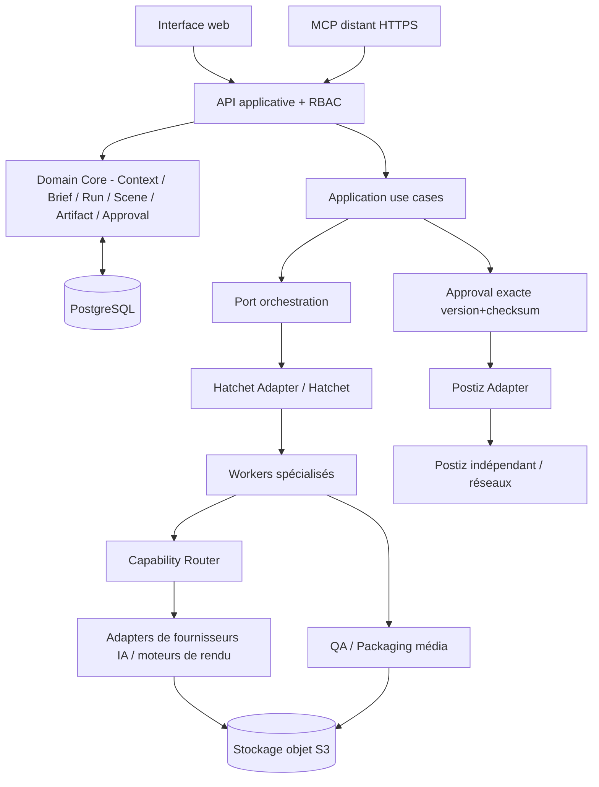

# Architecture de référence V1 — Domain Core + Hatchet + PostgreSQL + MCP + Postiz
**Statut : décision de conception ; implémentation et tests réels à produire.**

## Frontières essentielles
**Domain** : modèles purs, règles de transitions, invariants, sans SDK IA, Hatchet ou Postiz. **Application** : use cases, contrôle de propriétés, budgets, autorisations, composition et idempotence. **Infrastructure** : postgres, S3, Hatchet, fournisseurs, FFmpeg, Postiz, MCP transport, observabilité.

**Modules** : `identity`, `contexts`, `projects`, `campaigns` (groupement simple), `workflow`, `briefs`, `agents`, `capabilities`, `providers`, `media`, `scenes`, `characters`, `artifacts`, `approvals`, `handoff`, `audit`, `costs`, `mcp`. Pour V1, **modular monolith** API + workers séparés plutôt que microservices multiples.

## Source de vérité et intégrité
- **PostgreSQL** : User/Invitation, BrandContext + revisions, Project, Campaign, WorkflowSelection, BriefRevision, AgentDefinition, AgentConfigVersion, Provider/Model/Capability, JobSpec, JobRun, StepRun, Scene/SceneVersion, Character/CharacterVersion, Artifact/ArtifactVersion, Approval, TransferRecord, CostEvent, AuditEvent.
- **S3 compatible** : uploads, références originales, frames, rushs, audio, proxy, masters, thumbnails. DB = URI de stockage non-public + SHA256 + MIME + dimensions/durée + rights + provenance.
- **Snapshot** figé (`context_revision_id`, `brief_revision_id`, `agent_config_version`, `provider_policy_version`, `workflow_definition_version`) dès le lancement d'un run pour reproductibilité. Les corrections créent un autre run/step plan et des versions.
- Les vecteurs, préférences apprises et remontées automatiques mémoire sont **V2** ; les discussions de brief restent traces de travail, non « souvenirs » déduits.

## Orchestration durable
`JobSpec → JobRun → workflow (Hatchet) → capability → provider resolver → provider adapter → normalized result → ArtifactVersion`. `StepRun` identifie step id, retries, effets de bord, coût et checkpoint. Les **Side effects** (génération tierce payante, Postiz) sont idempotents si l'API le permet ; sinon ledger + réconciliation, pas de garantie « exactement une fois » inventée. Les pauses d'approbation durables résident côté application/DB, pas dans une session web.

## Agents (sans dépendance à un modèle)
- **L1 — direction créative** : agent contextuel initial + creative director / planner ; compile des sorties structurées et un graphe des dépendances.
- **L2 — spécialistes** : scénario/copy, DA/storyboard, image, animation/motion, vidéo, voix off, musique/licence, sous-titres, montage/mix ; seuls certains sont nécessaires par projet.
- **L3 — validateurs** : technique média, marque/texte, droits/licences, revue de complétude, QA avant remise.
- Chaque agent possède `AgentDefinition`, `AgentConfigVersion` (soul, instructions, garde-fous) et `capability_requirements`. Un fournisseur IA n'est qu'un moyen ; l'agent n'est jamais confondu avec « GPT/Google/Seedance ».

## Cohérence visuelle et edit local
`Scene` a `scene_id` stable + `SceneVersion` ; `Character` a `character_id` stable + `CharacterVersion` (fiche de référence : photos autorisées, traits, garde-robe, prompt seed, asset checksums). Les « IDs personnages » propres aux API providers sont conservés comme **bindings facultatifs** ; continuité cross-provider non garantie automatiquement. Modifier scène 3 déclenche nouvelle `SceneVersion` + invalidation des étapes descendantes seulement. Les scènes restantes conservent leurs masters/proxies si aucune dépendance globale modifiée (musique, transitions, grading, etc.).

## Audio
Script voix off versionné → synthèse/recording authorized → musique sélectionnée/chargée + droits → FFmpeg ou outil équivalent pour normalisation, ducking, choix de volume voix/musique, limites de crête → QC → master. Respecter les profils d'export par plateforme ; calibration automatique révisable par l'utilisateur.

## MCP : même domaine, entrée différente
`MCP tool → token auth/scopes/RBAC → application use case → command/query → résultat typé` ; aucune connexion MCP directe à PostgreSQL/Hatchet/Postiz. Les tâches longues rendent `run_id` immédiatement, suivi par query ; la présence d'une extension MCP tasks est **facultative** selon client compatible. Même approvals et checksums que le web.

## Extension V2 sans réécriture
Ajouter plus tard `SemanticMemoryStore`/`MemoryPolicy` comme **ports séparés** derrière `ContextResolver` et conserver les snapshots V1 ; ajouter `BillingLedger`/`EntitlementPolicy` derrière services de coûts sans polluer le Domain Core avec Stripe ; catalogue fournisseurs admin déjà extensible. **Aucun code actif V2 demandé.**

## Contraintes d'exploitation
Hatchet propre à VULULUIA ; ne pas partager base/namespace avec Temporal de Postiz. Workers CPU pour texte/motion programmatique/transcoding léger ; workers GPU séparables. Workers peuvent être désactivés sans interrompre UI. Authentification, chiffrement et secrets exclusivement serveur.
