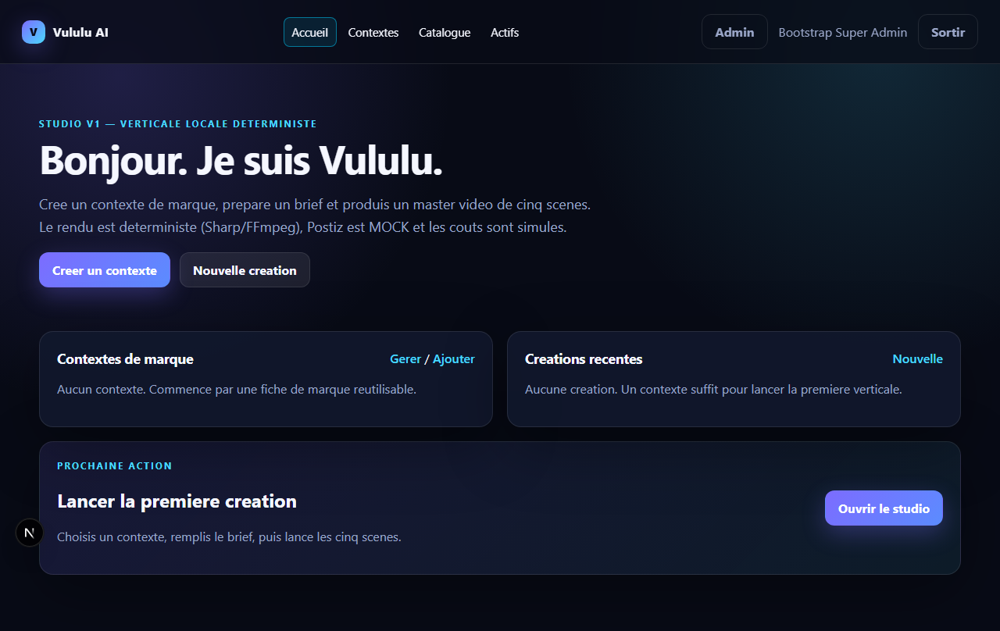
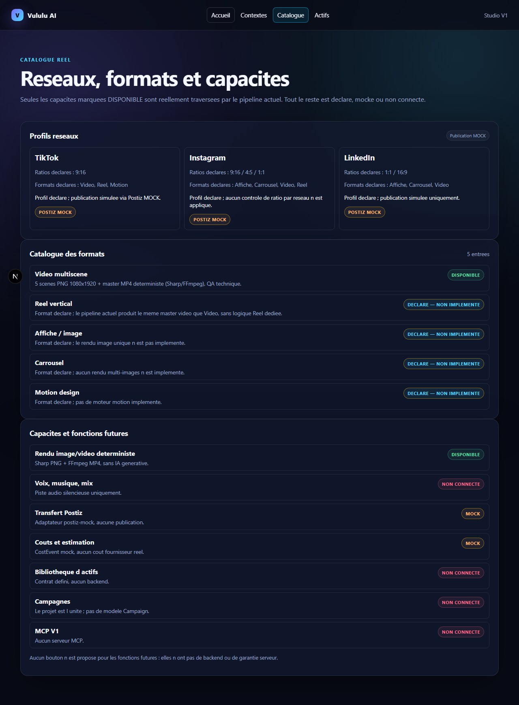
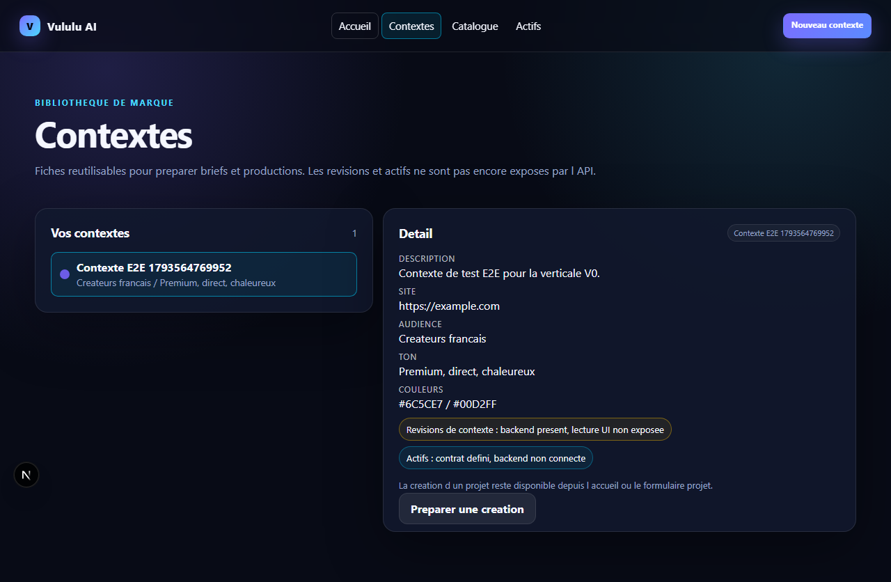
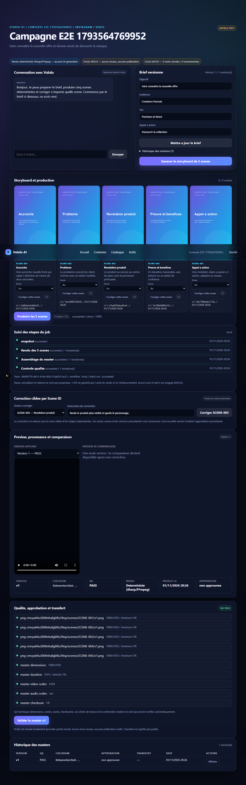
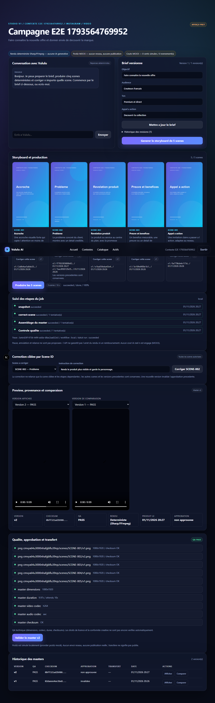

# VULULU V1 — Recette et preuve d'utilisation (environnement Coolify STAGING)

- Date : 2026-11-01
- Auteur : QA/release V1
- Périmètre demandé : Mission 07 — preuve d'utilisation réelle et décision de recette sur l'environnement Coolify STAGING
- **Décision : NO-GO pour l'accès privé STAGING / NO-GO pour une activation publique.**
- Aucun déploiement, aucun push, aucune activation publique pendant cette mission.
- Preuves disponibles : campagnes locales reproductibles sur base isolée, captures Studio V1, tests E2E/API ; **aucune preuve d'exécution sur un environnement STAGING Coolify réel**.

## 0. Synthèse exécutive

Le socle V1 est **démontrable localement** : connexion, contextes, projets, brief versionné, storyboard 5 scènes, rendu MP4 déterministe, QA technique, correction de n'importe quelle scène, comparaison de masters, approbation exacte, transfert Postiz MOCK, admin séparé super_admin, sessions/CSRF, RBAC/IDOR, base vierge migrée, redémarrage PostgreSQL et restauration DB+S3 sur ressources locales.

En revanche, **aucun environnement STAGING Coolify n'est accessible ni déployé** :
- aucune URL, aucun VPS, aucun projet Coolify, aucune image API/Web construite (Docker Desktop data disk read-only) ;
- aucune preuve d'utilisation réelle sur staging, aucun redémarrage de conteneurs API/Web/worker, aucun rollback conteneurisé, aucune sauvegarde/restauration sur le stockage de staging ;
- les providers IA, Postiz et les coûts restent MOCK ; le mode d'orchestration par défaut est local.

**Verdict** : GO technique local pour poursuivre le développement ; **NO-GO pour ouvrir un accès privé STAGING** tant que les conditions de la section 9 ne sont pas satisfaites. Aucune activation publique n'est proposée ni autorisée.

## 1. Baseline release relevée

| Élément | Valeur vérifiée |
|---|---|
| SHA main local | 8ffeba40b68b43807579d53865969417530a901c |
| SHA origin/main | d07a02e9a91cb89b796655eb72ede5478caa2479 (aucun push) |
| Arbre de travail | propre avant rapport (captures/rapport ajoutés ensuite) |
| Node / pnpm | 24.21.0 / 10.6.1 |
| PostgreSQL | 17.2 local (127.0.0.1:55432) — environnement de test uniquement |
| Prisma / migrations | 6.19.3 / 12 migrations additives |
| Next / Fastify / React | 16.4.2 / 5.12.7 / 19 |
| FFmpeg | 9.0.2-essentials |
| Images API/Web | **aucune image construite, aucun tag/digest de staging** ; seul l'ancien image Hatchet de POC existe localement |
| Docker | 29.8.1 ; données Docker Desktop read-only (écriture impossible) |
| Base d'acceptation locale | vululu_m07_acceptance_20261101202047 (créée, 12/12 migrations) |
| Services Coolify STAGING | **aucun service déployé** ; Compose défini seulement (db, migrate, api, web, profils worker/durable/s3) |
| URL staging | **aucune URL fournie ni vérifiable** |
| Paramètres non secrets | API interne 3101, Web 3100, health /api/health, admin /admin ; variables documentées dans infra/coolify/.env.coolify.example |
| Secrets | aucun secret affiché, aucun secret commité ; scan PASS |

## 2. Parcours exécutés (preuves locales, PAS staging)

Les parcours ont été exécutés sur API/Web locaux, base d'acceptation isolée, avec rendu MP4 réel et services mock ; **ils ne valent pas preuve STAGING**.

| Parcours | Résultat local | Preuve |
|---|---|---|
| USER : login, contexte, projet, brief, storyboard, production MP4, QA, correction SCENE-002, comparaison v1/v2, approbation, transfert MOCK, reload, logout | **PASS local** | e2e/v0.spec.ts, 1/1 PASS (1,3 min) ; captures 01 à 05 |
| SUPER_ADMIN : login, overview, utilisateurs/invitations, agents, fournisseurs, jobs, audit, coûts, réglages | **PASS local** | e2e/admin.spec.ts, 2/2 PASS (super_admin + refus user + mobile) |
| Contrôle d'accès inter-user / IDOR | **PASS local** | tests auth-security + api.test.ts + E2E Admin refus 403 |
| Sessions / CSRF | **PASS local** | tests sessions/CSRF, E2E login/cookies |
| Audit | **PASS local** | AuditEvent, tests hardening ; mutations admin auditées |
| États d'erreur / indisponibles | Partiel | écrans d'erreur, toasts, badges NON CONNECTÉ/MOCK ; non testés sur staging |
| Mock affiché | **PASS local** | bannières rendu déterministe, Postiz MOCK, coûts MOCK vérifiées par E2E |
| Santé API | **PASS local** | GET /api/health 200, y compris via proxy Next |
| Logs sans secret | PASS local (scan) | check-secrets.ps1 ; redaction logger ; logs staging non disponibles |
| Accès DB privé | PASS local par configuration | Compose ne publie pas 5432 ; staging non déployé donc non vérifié |

Captures (données de test locales, aucun secret) :

## 3. Résilience, redémarrage, sauvegarde/restauration

| Élément | Statut | Détail |
|---|---|---|
| Migrations sur DB vierge | **TESTÉ (local)** | vululu_m07_acceptance_20261101202047 : 12/12 PASS, migrate status up to date |
| Redémarrage PostgreSQL local + persistance | **TESTÉ (local)** | marqueur m07-persistence inséré, arrêt/démarrage PG, marqueur toujours présent |
| Redémarrage conteneurs API/Web/worker | **NON TESTÉ** | Docker read-only ; aucun déploiement staging |
| Persistance volume DB conteneurisé | **NON TESTÉ** | dépend du test conteneur/staging |
| Persistance objets S3 / remplacement conteneur | **NON TESTÉ (staging)** | sauvegarde/restauration locale S3 rclone PASS en Mission 05, pas sur staging |
| Sauvegarde/restauration DB+S3 | **TESTÉ (local, Mission 05)** | BACKUP_PASS + RESTORE_PASS, comptages/SHA/objet de preuve ; pas rejoué sur staging |
| Rollback code/conteneur | **NON TESTÉ** | procédure écrite (tag d'image, migrations additives, backup) ; aucun conteneur déployé |
| Validation de la stratégie de rollback | **NON TESTÉ** | nécessite staging + images + données réelles |
| Worker / Hatchet reprise après crash | **NON TESTÉ (runtime complet)** | outbox et reprise applicative testées ; topologie Hatchet complète bloquée |

## 4. Matrice CDC V1.2 — statut réel

Légende : CODÉ (implémenté), TESTÉ LOCAL (exécuté localement, pas staging), MOCK (contrat simulé), NON TESTÉ (aucune exécution), ABSENT, HORS PÉRIMÈTRE. Aucun PASS staging n'est déclaré.

| Exigence | Statut V1 | Preuve / limite |
|---|---|---|
| CDC-F-001 invitations | TESTÉ LOCAL | tests invitations + E2E admin |
| CDC-F-002 isolation/IDOR | TESTÉ LOCAL | tests IDOR/RBAC |
| CDC-F-003 page super-admin | TESTÉ LOCAL | Mission 03 + E2E admin |
| CDC-F-010 BrandContext | TESTÉ LOCAL (partiel) | champs simples ; pas de logos/social/assets |
| CDC-F-011 agent contextualisation | ABSENT | aucune analyse/validation assistée |
| CDC-F-012 snapshot contexte | PARTIEL | contextId/revisions domaine ; snapshot de run non exposé UI |
| CDC-F-013 assets/campagnes | ABSENT | contrat Asset seulement (page NON CONNECTÉ) |
| CDC-F-020 réseau/format/objectif | PARTIEL | sélection plateforme/format ; ratios/sponsorisé absents |
| CDC-F-021 voix | ABSENT | — |
| CDC-F-022 musique | ABSENT | — |
| CDC-F-023 mix audio | ABSENT | piste AAC silencieuse |
| CDC-F-024 BriefRevision | TESTÉ LOCAL | revisions + checksums + UI |
| CDC-F-030 DAG director | MOCK/PARTIEL | pipeline déterministe fixe, pas de DAG agentique |
| CDC-F-031 agents/configs/rollback | TESTÉ LOCAL | use cases + admin UI |
| CDC-F-032 registre providers | TESTÉ LOCAL / MOCK | registre réel, providers mock |
| CDC-F-033 routeur/fallback | TESTÉ LOCAL / MOCK | routage fallback mock tracé |
| CDC-F-040 Scene/Character ID | TESTÉ LOCAL | IDs stables, correction SCENE-002 E2E |
| CDC-F-041 artefacts/checksums | TESTÉ LOCAL | versions immuables, SHA |
| CDC-F-042 correction ciblée | TESTÉ LOCAL | master v2, autres checksums inchangés |
| CDC-F-043 exécution durable | PARTIEL / NON TESTÉ runtime | outbox + worker tests ; Hatchet complet non testé |
| CDC-F-044 preview/commentaires | PARTIEL | preview + comparaison ; commentaires par scène absents |
| CDC-F-050 QA machine | TESTÉ LOCAL | dimensions/codecs/durée/checksums |
| CDC-F-051 approbation exacte | TESTÉ LOCAL | version+checksum, invalidation |
| CDC-F-052 Postiz handoff | MOCK | postiz-mock, aucun réseau |
| CDC-F-060 administration minimale | TESTÉ LOCAL | UI/API admin ; clés providers non gérées |
| CDC-F-061 estimation/plafond coûts | MOCK / PARTIEL | coûts MOCK, pas d'estimation fournisseur réelle |
| CDC-F-070 MCP | ABSENT | — |
| CDC-F-071 sécurité MCP | HORS PÉRIMÈTRE | dépend de F-070 |
| CDC-F-080 P1 | ABSENT | différé |
| CDC-N-001 RBAC serveur | TESTÉ LOCAL | tests + E2E |
| CDC-N-002 secrets serveur | TESTÉ LOCAL | scan PASS ; staging non vérifié |
| CDC-N-003 HTTPS/CSRF/SSRF/uploads | PARTIEL | CSRF/sessions testés ; HTTPS staging non testé ; uploads absents |
| CDC-N-004 reprise/idempotence | PARTIEL | outbox/idempotence testés ; redémarrage conteneur NON TESTÉ |
| CDC-N-005 audit corrélé | TESTÉ LOCAL | AuditEvent + traceId |
| CDC-N-006 S3/checksums | PARTIEL | S3 TLS local + backup/restore ; staging NON TESTÉ |
| CDC-N-007 tests reproductibles | TESTÉ LOCAL | 188 tests, E2E ; CI distante NOT RUN |
| CDC-N-008 accessibilité | PARTIEL | labels/Tab/aria-live ; audit complet absent |
| CDC-N-009 licences/provenance | ABSENT | pas de validation de droits |
| CDC-N-010 prompts/rollback | TESTÉ LOCAL | admin agents |
| CDC-N-011 backup/rétention | PARTIEL | restore local PASS ; staging et rétention NON TESTÉS |
| CDC-N-012 monitoring/alertes | PARTIEL | health/metrics ; alerting absent |
| États run/step/transfer | PARTIEL/MOCK | états réels ; transfert MOCK |
| Recette docs/10 section E | NON TESTÉ | catalogue SPECIFIED, campagne complète non exécutée |

## 5. Défauts et dette technique

| ID | Constat | Gravité | Traitement |
|---|---|---|---|
| D-07-01 | Aucun staging Coolify déployé/accessible | bloquant recette | déployer selon COOLIFY_RUNBOOK après autorisation |
| D-07-02 | Images API/Web non construites (Docker read-only) | bloquant staging | réparer Docker ou builder sur VPS |
| D-07-03 | Redémarrage conteneurs/worker et rollback non testés | élevée | exécuter le protocole staging |
| D-07-04 | Providers IA/Postiz/coûts MOCK | élevée produit | lot fournisseur réel |
| D-07-05 | Mode local par défaut, Hatchet non validé bout en bout | élevée | test durable staging |
| D-07-06 | Audio, assets, formats avancés, MCP absents | moyenne | lots suivants |
| D-07-07 | CI distante/GitHub Actions non exécutée | moyenne | décision humaine, hors chantier |
| D-07-08 | Images lourdes (deps dev + tsx) | moyenne | next standalone/prune |
| D-07-09 | Révisions de contexte non exposées, commentaires scène absents | moyenne | UI/backend lot Studio+ |
| D-07-10 | Documentation partiellement en retard (README/ROADMAP) | faible | lot docs |

## 6. Risques

| Risque | Gravité | Mitigation |
|---|---|---|
| Ouvrir un accès privé sans staging testé | élevée | NO-GO maintenu |
| Régression non détectée sur Linux/Coolify | moyenne | smoke tests staging obligatoires |
| Perte de données au redémarrage/rollback | élevée | volumes persistants + backup/restore testés staging |
| Fuite de secret via logs/erreurs | élevée | scan, redaction, revue staging |
| Promesse commerciale sur des mocks | élevée | badges MOCK visibles + formation |
| Coûts réels non maîtrisés | élevée | lots providers avec budget/plafond |
| Dépendance Hatchet non stabilisée | moyenne | test de reprise staging |

## 7. Ordre des lots proposé (sous validation utilisateur et budget)

1. **Lot A — premier fournisseur IA réel + assistant LLM + storyboard dynamique** : contrat provider réel (usage/coût/latence/licence), credentials serveur, quotas, assistant conversationnel borné, storyboard généré avec validation humaine, coûts réels normalisés et plafonnés. Aucun autre provider avant validation.
2. **Lot B — image/vidéo réelles** : adaptateurs image puis vidéo, durées/résolutions, QA étendue, fallback contrôlé.
3. **Lot C — audio/voix/musique/mix** : TTS, licences, ducking, QA audio.
4. **Lot D — Postiz réel** : API qualifiée, OAuth/credential, idempotence, états réels, transfert sans publication automatique.
5. **Lot E — MCP** : serveur authentifié, scopes, parité web, tests IDE/cloud.
6. **Lot F — Studio+ / actifs / campagnes / formats avancés**, accessibilité complète, CI distante.
Chaque lot : budget validé, preuves, rollback, arrêt avant activation publique.

## 8. Conditions de passage à GO (accès privé staging)

1. Déployer réellement Coolify STAGING (images construites, DB, API, Web, worker, S3/stockage choisi) selon le runbook.
2. Rejouer ce protocole complet **sur staging** : parcours USER et SUPER_ADMIN, IDOR/sessions/CSRF/audit, états d'erreur, logs sans secrets, DB privée, HTTPS.
3. Tester redémarrage contrôlé API/Web/worker, persistance DB/S3, sauvegarde/restauration sur ressources de test.
4. Valider le rollback (image précédente + schéma compatible + restauration testée).
5. Faire signer une décision humaine explicite d'accès privé ; aucune activation publique automatique.
6. Maintenir les badges MOCK et ne pas présenter de contenus générés comme IA.

## 9. Décision

- **NO-GO pour l'accès privé STAGING** à ce stade.
- **NO-GO pour toute activation publique**, par défaut et sans instruction contraire.
- **GO technique local** pour poursuivre le développement (socle et Studio V1 démontrés localement).
- Prochain jalon : satisfaire les conditions de la section 8, puis prononcer un GO/NO-GO staging sur preuves réelles.

## 10. Annexe — commandes et preuves locales

    pnpm install --frozen-lockfile
    pnpm typecheck
    LINT_STRICT=1 pnpm lint
    pnpm build
    pnpm exec vitest run tests/domain tests/api.test.ts tests/v1 tests/media.test.ts
    # 188 PASS / 2 SKIP / 0 FAIL

    # Base vierge isolée
    prisma migrate deploy --schema packages/db/prisma/schema.prisma
    prisma migrate status --schema packages/db/prisma/schema.prisma
    # 12/12 migrations, up to date

    # E2E local (API 3101 + Web 3100, base d'acceptation)
    CAPTURE_STUDIO=1 pnpm exec playwright test e2e/v0.spec.ts e2e/admin.spec.ts --reporter=list
    # 3/3 PASS ; captures docs/reports/studio-v1-captures

    # Redémarrage PostgreSQL local
    # marqueur m07-persistence inséré, pg stop/start, marqueur toujours présent

    # Scan secrets
    pwsh -NoProfile -File scripts/check-secrets.ps1
    # SECRET_SCAN_PASS

Références : docs/studio/STUDIO_V1_WALKTHROUGH.md, docs/reports/VULULU_COOLIFY_BUILD_EVIDENCE.md, docs/reports/COOLIFY_STAGING_REPORT.md, docs/preprod/RUNBOOK.md, docs/coolify/COOLIFY_RUNBOOK.md.
